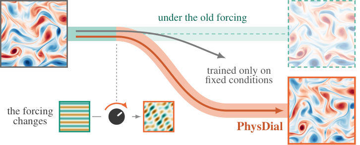
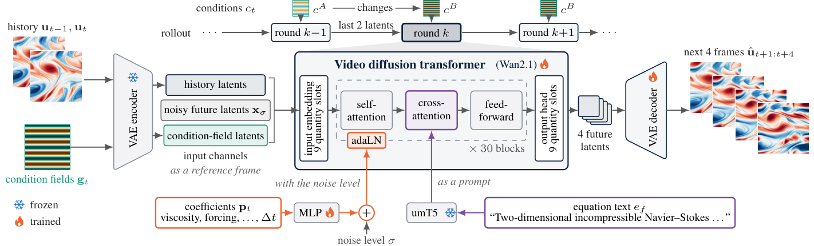
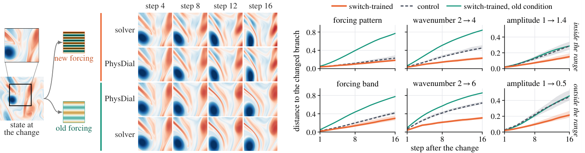

<br>
<p align="center">

<h1 align="center"><strong>PhysDial: Adapting Pretrained Video Models for PDE Simulation<br>under Changing Physical Conditions</strong></h1>
  <p align="center">
              <a>Yilong Dai<sup>1</sup>,</a>
              <a>Yiming Sun<sup>2</sup>,</a>
              <a>Shengyu Chen<sup>3</sup>,</a>
              <a>Jiaqi Gong<sup>1</sup>,</a>
              <a>Xiaowei Jia<sup>2</sup>,</a>
              <a>Runlong Yu<sup>1</sup></a>
    <br>
    <sup>1</sup>The University of Alabama, <sup>2</sup>Rutgers University, <sup>3</sup>University of Pittsburgh<br>
  </p>

<p align="center">
  
  <a href="https://github.com/Dyloong1/PhysDial/blob/main/LICENSE" target="_blank">
    
  </a>
  <a href="https://huggingface.co/Wan-AI/Wan2.1-T2V-1.3B-Diffusers" target="_blank">
    
  </a>
  
</p>


## 🔥 News

- **[2026-11]** Code released: data generation, training, evaluation, baselines, and the scripts behind every table and figure of the paper.

## 🌊 What is PhysDial?

Simulating how physical systems respond to **changing conditions** is central to control, design, and scenario studies:
the governing equation stays the same, but its coefficients or forcing change within a trajectory, and the system heads
for a different future. To our knowledge, prior PDE foundation models have not been trained or evaluated on such changes.

**PhysDial** adapts a pretrained text-to-video diffusion transformer (Wan2.1-T2V-1.3B) into an autoregressive simulator for
**eight two-dimensional PDE families**. Every physical input enters through the pathway of the video generator that plays
the same role: **coefficients** enter with the noise level (adaLN), **condition fields** as reference frames on the input
channels, and the **equation text** as a prompt. A **counterfactual two-branch test** measures how far a prediction moves
toward the changed solver branch from the same state.

<div align="center">
  
</div>

Main findings:

- Models trained on fixed conditions follow a change only in part, and a PDE foundation model given a condition input
  after pretraining barely responds.
- In Kolmogorov flow, **switch trajectories** (about 5% of the training samples) **halve the error after a change** in
  forcing wavenumber or amplitude at matched compute.
- A few **anchor trajectories** at new amplitudes more than halve the extrapolation error.
- Without physics pretraining, PhysDial matches or exceeds PDE foundation models under the training conditions of two
  turbulent flows, and keeps the energy spectrum close to the solver's over 64-step rollouts.

If you find this repository or our paper useful, please consider **starring** the repository and **citing** the paper
(see [Citation](#-citation)).

## 🧩 Method

<div align="center">
  
</div>

Each round takes **2 history frames and predicts 4 frames** (one round = 4 prediction steps). Rollouts run in the latent
space of the video VAE and are decoded at the end of each round.

| physical input | pathway in the video generator |
|---|---|
| scalar coefficients (viscosity, Reynolds number, forcing amplitude, ...) and the frame spacing dt | a numeric vector -> MLP -> added to the timestep embedding (adaLN modulation). The vector has 51 entries: 12 parameter slots (`corpus.SLOTS`) with a presence mask each (24), and three state scalars per quantity slot (27: log amplitude, mean / amplitude, presence) |
| condition fields (Kolmogorov forcing pattern, acoustic medium) | encoded with the same VAE and concatenated on the input channels, like a reference frame |
| equation identity | text through the frozen umT5 encoder and the existing cross-attention |

New input channels and new layers are zero-initialised, so training starts from the pretrained generator's behaviour.
Further components:

- **Decoder fine-tuning** of the Wan2.1 VAE on the physical fields (encoder frozen, so latent stores stay valid).
- **Periodic-domain handling**: circular padding in the VAE, periodic RoPE harmonics, random integer latent shifts during training.

Two kinds of training data make the conditions necessary:

- **Anchor trajectories**: Kolmogorov flow at forcing amplitudes 0.7 and 1.4, while the main sweep keeps amplitude 1.
- **Switch trajectories**: a condition (forcing amplitude, viscosity, forcing wavenumber or forcing pattern) changes
  mid-trajectory (`switch/groups_kolmo_train.json`: 72 groups, 32 amplitude, 24 viscosity, 8 wavenumber, 8 pattern).
  The loss covers only the frames after the change, so the model can only predict them by reading the new condition.

<div align="center">
  
</div>

Baselines: Walrus (fine-tuned with its own training code), DPOT-H, per-family U-Net and FNO specialists, and a Walrus
variant that also receives the conditions.

## 📑 Table of Contents

- [🚀 Install](#-install)
- [📥 Data](#-data)
- [🏋️ Training](#%EF%B8%8F-training)
- [📏 Evaluation](#-evaluation)
- [📊 Tables and figures](#-tables-and-figures)
- [📂 Repository layout](#-repository-layout)
- [⚙️ Environment variables](#%EF%B8%8F-environment-variables)
- [🧱 Third-party components](#-third-party-components)
- [📜 Citation](#-citation)

---

## 🚀 Install

```bash
git clone https://github.com/Dyloong1/PhysDial.git
cd PhysDial
pip install -r requirements.txt
source scripts/00_env.sh        # sets the data / cache paths below (defaults inside the repository)
```

Python ≥ 3.10 and CUDA GPUs (the training runs use 4 GPUs; evaluation 1–4). Walrus and DPOT run from their own
repositories and environments (see [Third-party components](#-third-party-components)).

The table scripts run on a CPU: `main_table.py`, `column_table.py` and `physics_report.py` need only the Python standard
library, `robust.py` numpy and scipy; `physics_fields.py` and `plot_data.py` also import torch (the spectral definitions of
`physdial/eval_metrics.py`), and `plot_data.py` h5py and matplotlib (through `switch/case_study.py`).

---

## 📥 Data

### The eight families

| key | family | source |
|---|---|---|
| `kolmo` | Kolmogorov forced turbulence (vorticity; nu, k_f, amplitude, forcing field) | own pseudo-spectral solver, `data_gen/kolmo2d` |
| `nsu` | freely decaying turbulence (vorticity; nu) | same solver, no forcing |
| `gs` | Gray-Scott reaction-diffusion (F, k) | The Well |
| `rb` | Rayleigh-Benard convection (Ra, Pr) | The Well |
| `sf` | shear flow (Re, Sc) | The Well |
| `trl` | turbulent radiative layer (t_cool) | The Well |
| `euler` | Euler multi-quadrants, open BC (gamma) | The Well |
| `acoustic` | acoustic scattering (medium density / sound-speed fields as conditions) | The Well |

All data are used on the grid of their solver or publisher and are never resampled or padded (every side is a multiple of
128 pixels, which the VAE and the baselines take as is). Each family has `train`, `val` and `test` splits plus held-out
condition columns (`interp_*`, `extrap_*`). The in-range reference runs use the `ref_*` splits: other trajectories of the
held-out conditions, added to training only for those reference runs. Split definitions are in `physdial/corpus.py`,
`data_gen/kolmo2d/splits_kolmo.json`, `tables/devsplit_ic.json` and `switch/groups_kolmo*.json`. `tables/devsplit_ic.json`
(the initial condition of every shear-flow and Rayleigh-Benard evaluation trajectory, which fixes the dev / test halves of
their windows) is derived from The Well data and shipped as is.

### Preparation (`scripts/01_data.sh`, `scripts/02_text_and_stores.sh`)

- **The Well**: `data_gen/the_well/fetch_well.py` downloads the six 2D datasets into `$PHYSDIAL_EXT_DATA/the_well`.
- **Kolmogorov flow and decaying turbulence**: generated with `data_gen/kolmo2d/gen_job.py` (pseudo-spectral solver in
  `kolmo_solver.py`, one GPU per job) into `$PHYSDIAL_DATA_ROOT/2d`. This includes the amplitude-anchor, drag-column and
  beta-plane groups.
- **Switch trajectories**: `switch/gen_switch.py` (single switch) and `switch/gen_ms.py` (multiple switches) write to
  `$PHYSDIAL_DATA_ROOT/switch`. The condition groups are defined in `switch/groups_kolmo*.json`.
- **Latent stores**: `physdial/encode_corpus.py` encodes every family once with the frozen VAE encoder.
  `physdial/textemb.py` embeds the equation descriptions with umT5.

```bash
# example: download two The Well families, then simulate one Kolmogorov sweep point
(cd data_gen/the_well && python3 fetch_well.py --datasets turbulent_radiative_layer_2D,gray_scott_reaction_diffusion --name fetch-well-trl-gs)
(cd data_gen/kolmo2d && python3 gen_job.py --set all --seed_offset 0 --only 2,0.5 --name gen-kolmo-sweep-kf2-amp0.5)
```

---

## 🏋️ Training

The scripts in `scripts/` list every run of the paper in dependency order. Each command has a short comment giving its run
name, GPU count and planned budget. GPU runs use `torchrun --standalone --nproc_per_node=<GPUs>`. Run names are used as file
names, and later runs refer to earlier ones by name (`--init_weights`, `--run`, `--tok`, ...).

- **Stage 1** (`physdial/train_gen.py`, 60 GPU-h): training on the eight families from the pretrained Wan2.1-T2V-1.3B.
  Each family is sampled with a temperature-scaled weight and a cap on passes per window.
- **Stage 2** (20 GPU-h): continues from stage 1, adds the Kolmogorov amplitude anchors and the periodic handling
  (circular padding, periodic RoPE harmonics, random integer latent shifts). The result is **PhysDial**. The controlled
  switch study starts from the same stage without the periodic handling (`stage2-noperiodic-s0` in `04_train_stage2.sh`).
- **Switch training** (`switch/train_switch.py`, 20 GPU-h): continues from PhysDial with Kolmogorov switch trajectories
  added to the training mixture. The loss covers only the frames after the switch. The control run has the same compute
  and no switch trajectories. The controlled study does the same from `stage2-noperiodic-s0` with two seeds.
- **Decoder fine-tuning** (`physdial/train_tok2d.py`): fine-tunes the VAE decoder on the physical fields with the encoder
  frozen. Evaluation decodes with it (`--tok wan21ft:<checkpoint>`). Each run ends with a reconstruction check
  (`physdial/tok_gate.py`): 24 frames of every evaluation split, decoded with the fine-tuned decoder; every channel must
  reach relative L2 <= 0.05 and gradient-energy ratio in [0.9, 1.1].

Every extrapolation result is paired with an in-range reference: the same architecture and budget, trained with the
held-out values included (`--reference`, `ref_*` splits).

```bash
# stage 1 (4 GPUs, 60 GPU-h)
(cd physdial && torchrun --standalone --nproc_per_node=4 -- train_gen.py \
    --store wan21 --ens 8 --ens_n 16 --ens_splits all --budget_gpu_h 60 --name physdial-stage1-s0)
```

| script | content |
|---|---|
| `01_data.sh` | The Well downloads, Wan2.1 weights, Kolmogorov / decaying-turbulence simulation, Kolmogorov switch trajectories |
| `02_text_and_stores.sh` | umT5 text embeddings of the equation descriptions; VAE latent stores (zero padding `wan21`, wrap-around padding `wan21_wrap`); switch-data latents |
| `03_train_stage1.sh` | stage 1: training on the eight families from the pretrained generator (60 GPU-h), plus its in-range reference |
| `04_train_stage2.sh` | stage 2: + Kolmogorov amplitude anchors + periodic handling (20 GPU-h) = PhysDial (two seeds), its in-range reference, and the same stage without the periodic handling |
| `05_decoder.sh` | VAE decoder fine-tuning (encoder frozen) |
| `06_switch_training.sh` | switch training of PhysDial (20 GPU-h) and its same-compute control; the controlled switch study (two seeds) and its in-range reference |
| `07_eval_physdial.sh` | evaluation of PhysDial (fine-tuned decoder, 64-step rollouts, text probes, extrapolation cost) |
| `08_eval_switch.sh` | single-switch and multi-switch evaluation and analysis |
| `09_baseline_walrus.sh` | Walrus: data export, fine-tuning, evaluation |
| `10_baseline_dpot.sh` | DPOT-H: fine-tuning, evaluation |
| `11_baseline_specialists.sh` | per-family U-Net / FNO specialists (+ in-range references, second seeds, 64-step rollouts, switch views) |
| `12_baseline_conditional_walrus.sh` | Walrus with condition inputs, with and without switch trajectories |
| `13_tables_figures.sh` | tables, plot data of the figures, case-study figures |
| `14_ablations.sh` | beta-plane coefficient anchors, no anchors, condition inputs removed (in training; condition fields zeroed at evaluation), random initialisation, 14B model with LoRA, regression objective, Walrus from scratch, decoder and periodic-handling controls, linear probes, further variants, repeated Walrus stage |

Outputs go next to the code: `physdial/results/<run>.json`, `physdial/ckpt/<run>.pt`, `physdial/baselines/*/results/`,
`switch/results/`, `analysis/results/`. Point `physdial/ckpt` at large storage (for example with a symlink) before
training.

---

## 📏 Evaluation

- **Columns**: each column (family x split) is scored on 32 fixed windows. The windows are shared by all models
  (`train_gen.eval_windows`, reused by the Walrus and DPOT evaluations).
- **Rollouts**: autoregressive, 2 history frames, 4 steps per round. Errors are reported at steps 4 and 16. Long-horizon
  diagnostics use 64-step rollouts (`--eval_chunks 16`, `tables/physics_fields.py`).
- **Sampler**: 25 Euler steps of the flow-matching ODE with sampling shift 8 (`--sample_shift 8`). The extrapolation cost
  (model / in-range reference on the same windows) is computed with the training shift 3 for both
  (`physdial-s0-eval-shift3`, `physdial-ref-s0-eval-shift3`).
- **Metrics** (`physdial/eval_metrics.py`): relative L2 error with physical diagnostics (spectral band energies,
  gradients, mean and amplitude drift).
- **Single switch** (`switch/eval_switch.py`, `switch/analyze_switch.py`): for every window and step, with S the switched
  truth, C the control truth (same history, the old condition kept) and P the prediction told the new condition, the
  **response coefficient** r = <P - C, S - C> / ||S - C||^2 (the projection of the predicted change on the true change in
  the field; 0 = the prediction stays on the old condition's future, 1 = it follows the switch). r is reported where the
  switch changes the future by at least 5% (window mean of ||S - C|| / ||S|| >= 0.05).
- **Multiple switches** (`switch/eval_ms.py`, `switch/analyze_ms.py`): several switches within one rollout. Per group, on
  the window means of a flow statistic X, the **tracking error**
  TE = rms_steps((P_told - P_untold) - (S - C)) / rms_steps(S - C), where P_told is told every new condition and P_untold
  keeps the first condition (same history, same sampling noise), so the model's own drift cancels; 0 = follows every
  switch, 1 = no response. The statistic per group: kinetic energy (amplitude switches), enstrophy (viscosity switches),
  projection of the flow on the forcing in effect (wavenumber, pattern and mixed switches).
- **Comparisons**: paired comparisons over shared windows are computed in `tables/robust.py`: geometric mean of the
  per-window ratio with a 95% bootstrap interval that resamples trajectories (2000 draws), and the Wilcoxon signed-rank test.

```bash
# PhysDial on all evaluation columns (2 GPUs), with the fine-tuned decoder
(cd physdial && torchrun --standalone --nproc_per_node=2 -- train_gen.py --eval_only physdial-s0 \
    --store wan21_wrap --tok wan21ft:decoder-wrap.pt --sample_shift 8 --kolmo_extra drag --name physdial-s0-eval)
```

---

## 📊 Tables and figures

`scripts/13_tables_figures.sh` builds the tables from the result files:

- `tables/main_table.py`: comparison on the two families Walrus did not see in pretraining (ratios ours / other, dev / test halves)
- `tables/robust.py`: paired statistics
- `tables/physics_report.py`: physics report
- `tables/column_table.py`: the per-column table of the paper: errors at steps 4 and 16 (Kolmogorov flow and decaying
  turbulence also step 64) of PhysDial, Walrus, DPOT-H, U-Net and FNO on the eight families, the second seeds, and the
  extrapolation cost of every column outside the training range (model / its in-range reference)
- `tables/physics_fields.py`: physical-field diagnostics of the 64-step rollouts
- `tables/plot_data.py`: CSVs of the figures: switch curves, controlled switch study, 64-step error curves, energy spectra
  (PhysDial, Walrus, DPOT-H, U-Net, FNO and the autoencoder), with checks against the evaluation JSONs

Case-study figures come from `switch/case_study.py` and `switch/ms_case.py`, which read the `--dump_pred` outputs.

---

## 📂 Repository layout

| Path | Contents |
|---|---|
| `physdial/` | Generator, corpus, latent stores, tokenizer, text embeddings, evaluation metrics |
| `physdial/baselines/walrus/` | Walrus fine-tuning / evaluation (+ Hydra configs in `cfg/`) |
| `physdial/baselines/dpot/` | DPOT-H fine-tuning / evaluation |
| `physdial/baselines/small_expert.py` | Per-family conditioned U-Net / FNO specialists |
| `switch/` | Kolmogorov switch trajectories: generation, encoding, switch training, evaluation, analysis (response coefficient, tracking error, multi-switch), conditional Walrus, case studies |
| `data_gen/kolmo2d/` | Kolmogorov / decaying-turbulence solver and generation jobs |
| `data_gen/the_well/` | The Well downloader |
| `tables/` | Main table, per-column table, paired robustness statistics, physics report, physical-field diagnostics, plot data of the figures |
| `analysis/` | Linear probes of the conditions, projection onto physical constraints |
| `scripts/` | Reproduction scripts, in run order |
| `runmeta.py`, `resume.py` | Run metadata, time-budgeted resumable training |

## ⚙️ Environment variables

| Variable | Meaning | Default (paths relative to the repository) |
|---|---|---|
| `PHYSDIAL_DATA_ROOT` | Generated data (`2d/`), latent stores, Walrus-format exports, switch data (`switch/`) | `./data` |
| `PHYSDIAL_EXT_DATA` | Public data: `the_well/` | `./data/ext` |
| `HF_HOME` | Hugging Face cache (Wan2.1-T2V-1.3B, umT5) | `./cache/huggingface` |
| `WALRUS_SRC` | Walrus source checkout | `./ext/walrus` |
| `WALRUS_CKPT_DIR` | Released Walrus checkpoint (`walrus.pt`, `extended_config.yaml`) | `./ext_models/walrus` |
| `DPOT_SRC` | DPOT source checkout | `./ext/DPOT` |
| `DPOT_WEIGHTS` | Released DPOT-H weights | `./ext/dpot_weights/model_H.pth` |

`scripts/00_env.sh` sets these (an existing value is kept and made absolute), and every other script sources it. The
Python modules use the same defaults when a variable is unset, except `HF_HOME`, for which the Hugging Face libraries then
use their own cache.

Optional, for preemptible jobs (`resume.py`; used by `train_gen.py`, `train_tok2d.py` and `dpot_ft.py`):

| Variable | Meaning |
|---|---|
| `PHYSDIAL_RESUMABLE` | `1`: save model, optimizer and random-generator state to `<checkpoint dir>/<run>.resume.pt` every 30 minutes, on SIGUSR1 and 10 minutes before `PHYSDIAL_DEADLINE`, then exit with code 99 so a scheduler can requeue the job; the next start resumes from that file. Unset or `0`: off |
| `PHYSDIAL_DEADLINE` | Unix time by which a resumable job must have saved (for example the end of a Slurm allocation) |
| `PHYSDIAL_REQUEUE_FLAG` | File that rank 0 writes when a resumable job exits for requeueing (torchrun reports a worker's exit code 99 as a generic failure) |
| `PHYSDIAL_GIT_SHA` | Code version recorded in every result JSON (`meta.git_sha`); default: the git commit of this checkout, if any |

## 🧱 Third-party components

| Component | License | Upstream |
|---|---|---|
| Wan2.1 (T2V-1.3B / 14B DiT and VAE) | Apache-2.0 | https://github.com/Wan-Video/Wan2.1, https://huggingface.co/Wan-AI/Wan2.1-T2V-1.3B-Diffusers |
| umT5 text encoder (shipped with Wan2.1) | Apache-2.0 | https://huggingface.co/google/umt5-xxl |
| Walrus | see upstream | https://github.com/PolymathicAI/walrus, https://huggingface.co/polymathic-ai/walrus |
| DPOT | see upstream | https://github.com/HaoZhongkai/DPOT |
| The Well | see upstream | https://github.com/PolymathicAI/the_well |

## 📜 Citation

```bibtex
@misc{dai2026physdial,
  title={PhysDial: Adapting Pretrained Video Models for PDE Simulation under Changing Physical Conditions},
  author={Yilong Dai and Yiming Sun and Shengyu Chen and Jiaqi Gong and Xiaowei Jia and Runlong Yu},
  year={2026},
  url={https://github.com/Dyloong1/PhysDial},
}
```

Machine-readable metadata: [`CITATION.cff`](CITATION.cff).

## ⚖️ License

Code: MIT (see [`LICENSE`](LICENSE)). Third-party models and datasets keep their own licenses (see above).
